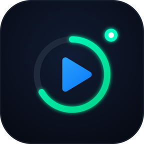
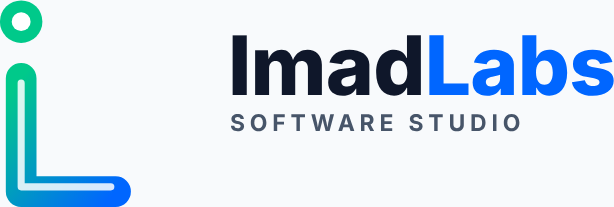

<div align="center">



# iPlayer

**Plays almost anything. Tracks nothing.**

A fast, private video and music player for Android, powered by the VLC engine.

[](https://github.com/ImadKhan1999/iPlayer/releases/latest)
[](https://github.com/ImadKhan1999/iPlayer/actions/workflows/ci.yml)
[-3ddc84?style=flat-square&logo=android&logoColor=white)](#install)
[](#built-with)
[](https://github.com/ImadKhan1999/iPlayer/releases)
[](https://t.me/ImadLabs)

[**Download**](https://github.com/ImadKhan1999/iPlayer/releases/latest) · [Features](#features) · [Install](#install) · [Compatibility](docs/COMPATIBILITY.md) · [Telegram](https://t.me/ImadLabs)

</div>

---

## Why iPlayer

- **Plays the files other players give up on.** MKV, HEVC, AV1, FLAC, DTS, ASS subtitles and
  more, through LibVLC, the engine behind VLC. Hardware decoding first, with automatic software
  fallback.
- **One app for video and music.** A full gesture-driven video player and a proper music library
  with an equalizer, lyrics and playlists.
- **Streams and network shares built in.** Open a URL or browse SMB, FTP, SFTP, NFS and UPnP
  servers without a separate app.
- **No ads, no analytics, no tracking.** Nothing leaves your phone unless you open a network
  source or turn on the update check.

## Features

### 🎬 Video player
- Swipe gestures for seek, brightness and volume, double-tap to skip, pinch to zoom, and hold for
  fast playback
- Playback speed from 0.25× to 4×
- Aspect modes, rotate and mirror, brightness, contrast and saturation controls
- A–B repeat, frame step, seek preview thumbnails and chapters
- Screen lock, picture-in-picture and background audio
- Resumes where you left off, with a media info panel for the nerdy details

### 💬 Subtitles
- Embedded and external subtitles: SRT, ASS/SSA, WebVTT, VobSub, PGS and more
- Matching subtitle files load automatically
- Adjustable delay, size, colour, outline, shadow, background and encoding
- Preferred subtitle and audio languages

### 🎵 Music
- Browse by songs, albums, artists, genres and folders
- Recently played, recently added, most played and favourites
- Playlists and a play queue
- 10-band equalizer, ReplayGain and volume normalizer
- Synced lyrics from `.lrc` files
- Lock screen, notification and Bluetooth controls
- Sleep timer

### 📚 Library
- Finds your videos and music automatically, grouped into folders
- Groups TV episodes into shows and seasons, with manual corrections
- Watch history and resume points (history can be turned off)
- Hide folders you don't want to see, including WhatsApp voice notes

### 🌐 Network
- Play HTTP(S), HLS, DASH and RTSP streams
- Browse SMB, FTP/FTPS, SFTP and NFS shares, and discover UPnP/DLNA servers
- Saved sources keep their passwords encrypted with the Android Keystore

### 🎨 Look and feel
- Dark, light or system theme with a choice of accent colours
- Smooth screen transitions, and the display's full refresh rate (for example 120 Hz)

### 🔒 Privacy and updates
- No ads, analytics or trackers
- Optional update check against signed GitHub releases. Every download is verified (SHA-256 and
  signing certificate) and nothing installs without your tap. See [how updates work](docs/UPDATES.md).

## Screenshots

> Screenshots are coming soon. See [docs/screenshots](docs/screenshots/README.md) to contribute some.

## Install

1. Open the [**latest release**](https://github.com/ImadKhan1999/iPlayer/releases/latest).
2. Download the APK for your phone:

   | APK | Pick it if |
   | --- | --- |
   | `iPlayer-<version>-arm64-v8a-release.apk` | ✅ **Recommended.** Almost every phone from the last several years |
   | `iPlayer-<version>-armeabi-v7a-release.apk` | Older or low-end 32-bit phones |
   | `iPlayer-<version>-universal-release.apk` | You're not sure. Works everywhere, but much larger |
   | `x86_64` / `x86` | Emulators and some Chromebooks |

3. Open the downloaded file and allow your browser or file manager to install unknown apps when
   Android asks.

> [!NOTE]
> **Google Play Protect may warn you** that the app is from an unknown developer or "hasn't been
> scanned". That's normal for apps installed outside the Play Store. Tap **More details ›
> Install anyway**. Every release is built by GitHub Actions from this repository, and its
> checksums are published in `SHA256SUMS.txt` next to the APKs.

**Requirements:** Android 8.0 (Oreo) or newer.

**Updating:** install a newer APK over the old one, or turn on **Settings › Updates › Check for
updates on launch** to be told when a new version is out. Your library, playlists and settings are
kept.

## Built with

| | |
| --- | --- |
| Language | [Kotlin](https://kotlinlang.org/) |
| UI | [Jetpack Compose](https://developer.android.com/compose) with Material 3 |
| Playback engine | [LibVLC](https://www.videolan.org/vlc/libvlc.html) 3.7 (VideoLAN) |
| Media session | [AndroidX Media3](https://developer.android.com/media/media3) |
| Storage | Room, DataStore |
| Images | Coil |

Supported formats, engine limits and test status are listed in
[docs/COMPATIBILITY.md](docs/COMPATIBILITY.md).

## Build from source

```
git clone https://github.com/ImadKhan1999/iPlayer.git
cd iPlayer
./gradlew assembleDirectDebug
```

You need JDK 17+ and the Android SDK (platform 37). Build flavors, signing, CI and the project
layout are covered in [docs/BUILDING.md](docs/BUILDING.md).

## Contributing

Bug reports, ideas and pull requests are welcome.

- **Found a bug?** [Open an issue](https://github.com/ImadKhan1999/iPlayer/issues/new) with your
  phone model, Android version, iPlayer version (Settings › About) and, if you can, the file type
  that failed.
- **Want to change something?** Fork the repo, make your change on a branch, make sure
  `./gradlew testDirectDebugUnitTest` passes, and open a pull request.
- **Just want to chat?** Join [t.me/ImadLabs](https://t.me/ImadLabs) for news and support.

## Credits and licences

iPlayer's own code © ImadLabs.

iPlayer stands on the shoulders of great open-source projects: **LibVLC** by VideoLAN
(LGPL-2.1+, dynamically linked and replaceable), AndroidX, Media3, Room, DataStore, Compose,
Kotlin libraries and Coil (Apache-2.0), and the Plus Jakarta Sans, Inter and JetBrains Mono fonts
(SIL OFL 1.1). Full licence texts ship inside the app under **About › Open-source licenses**.

<div align="center">
<br>

<picture>
  <source media="(prefers-color-scheme: dark)" srcset="app/src/main/res/drawable-nodpi/imadlabs_logo_on_dark.png">
  
</picture>

Made by **ImadLabs** · [Telegram](https://t.me/ImadLabs)

</div>
